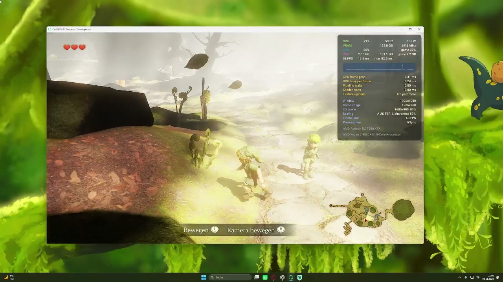
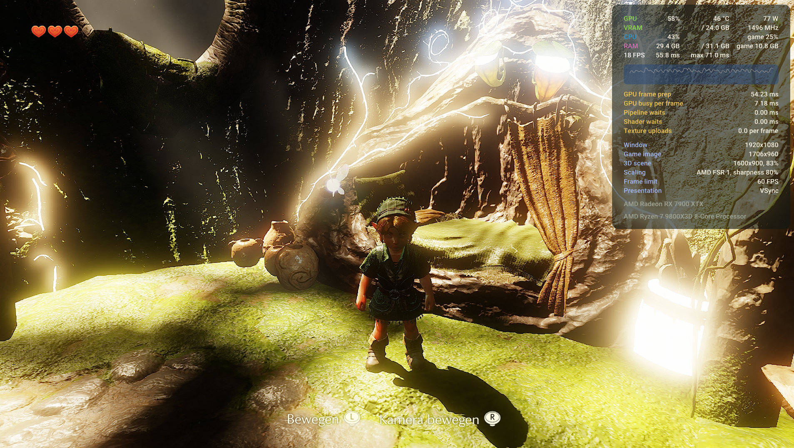

# Ocarina of Time — PC Native Build

## Gameplay Update

**[▶ Watch the full gameplay video — 4:07](https://ocarina-pc-native-build.github.io/#gameplay)**

I’ve now tested a bit of actual gameplay. **As you can see, there are still graphical glitches, but gameplay runs smoothly overall in the sections I’ve tested so far.**

The biggest issues remain **flickering, overexposure and other rendering errors**. I’m continuing to work on those fixes, but it’s encouraging to see the game running beyond the menus and into actual gameplay!

[Open the MP4 video directly](https://ocarina-pc-native-build.github.io/gameplay.mp4)

---

### Native Windows x64 recompilation · Switch 2 → PC

**Experimental build · Gameplay tested in some sections · Graphics fixes in progress**

I’m working on a native Windows x64 recompilation of the Switch 2 version of **Ocarina of Time**. The goal is to run the translated game code with a Windows runtime and a Vulkan graphics backend.

This project page documents my current development progress and the next steps. **There is no playable release yet.**

**Project website:** [ocarina-pc-native-build.github.io](https://ocarina-pc-native-build.github.io/)  
**Discord:** [Join our Discord](https://discord.gg/vDPAcc6JnY)  
**Maintainer:**  https://github.com/HotDevilSauce
**Status updated:** November 5, 2026  
**Latest documented commit:** `e6125e6`  
**Latest report:** [Gameplay Update](https://ocarina-pc-native-build.github.io/#gameplay)  
**Earlier detailed report:** [Development Update #01](UPDATE-01.md)

## Earlier Development Update #01 — we’re now in-game!

**November 5, 2026 · Latest documented commit: `e6125e6`**

The build has progressed beyond the menus and now reaches an actual **3D in-game scene**, including the Deku Tree and dialogue. Basic movement appears possible, but the rendering problems need attention before we can properly assess gameplay.

**The next priority is fixing the overexposure, flickering and other graphical errors.**

*In-game development screenshot · November 5, 2026. Heavy overexposure is visible; graphics fixes are still in progress.*

### Latest recorded test results

Testing used an **AMD Radeon RX 7900 XTX**.

| Metric | Latest recorded result |
| :--- | :--- |
| Vulkan errors in the tested menu/options path | **0** |
| Shader error reports | **111**, down from **464** |
| Runtime checks passed | **15** |
| Project tests passed | **17** |
| GPU checks passed | **245** |

The zero Vulkan error count applies to the tested menu/options path. Shader report counts do not necessarily represent distinct shaders or root causes.

### Current focus and development status

- **Graphics first:** correct lighting and colour output, eliminate flickering, and fix the shader and rendering errors affecting the visible scene. The overexposure and other rendering defects **are not fixed yet**.
- **Gameplay and stability:** the latest follow-up reports smooth gameplay overall in the sections tested so far. Broader playability, longer-run stability and saving/loading still need verification.
- **Earlier CPU crash:** the previously reported longer-run crash has **not been confirmed resolved**. The earlier report recorded a stop around frame **23,250** at `main+0x1661690`.

This remains an **experimental development build**, not a finished playable release.

[Read the full Development Update #01](UPDATE-01.md) for the runtime, AV1, PACGA and menu fixes · [Detailed roadmap](ROADMAP.md) · [Development changelog](CHANGELOG.md)

## Earlier development video

[Watch the development video on the project website](https://ocarina-pc-native-build.github.io/#video) · [Open the MP4 recording](https://ocarina-pc-native-build.github.io/development-video.mp4) (14.7 MB)

Earlier startup/menu footage recorded November 5, 2026. This video does not show the new 3D milestone in Update #01. The banner above is project artwork.

## Join the community

[Join our Discord](https://discord.gg/vDPAcc6JnY) to discuss development progress, share feedback, and connect with other project followers.

## Support the project

I’m developing this project independently. Voluntary support helps cover **development tools, testing, and ongoing development work**, including investigating bugs and documenting progress.

**[Buy Me a Coffee](https://buymeacoffee.com/hotdevilsauce)** — support independent development.

Support is optional and does not purchase a game, early access, or a guaranteed release. Following the project and sharing useful feedback also help.

## Development platform

The target platform is **Windows x64 with Vulkan**. The reported graphics test was performed on a **Radeon RX 7900 XTX**. The intended development PC uses a Ryzen 7 9800X3D and 32 GB RAM.

These details describe the development machine, **not minimum system requirements**. 1440p and 60 FPS are targets, not achieved or guaranteed performance figures.

## Release

This package contains only the project description and status website. It contains **no ROMs, Nintendo keys, extracted game assets, generated game code, or game binaries**. No download sources for these are provided here.

A public source-code release, installer, and release date have not been announced. The local commit identifiers document the reported development state; this status site does not automatically include the associated code history.

This is an unofficial project and is not affiliated with Nintendo.

---

*All progress claims refer to local development reports. The latest gameplay report applies to the sections tested so far. Broader playability, longer-run stability and saving/loading still need verification.*
