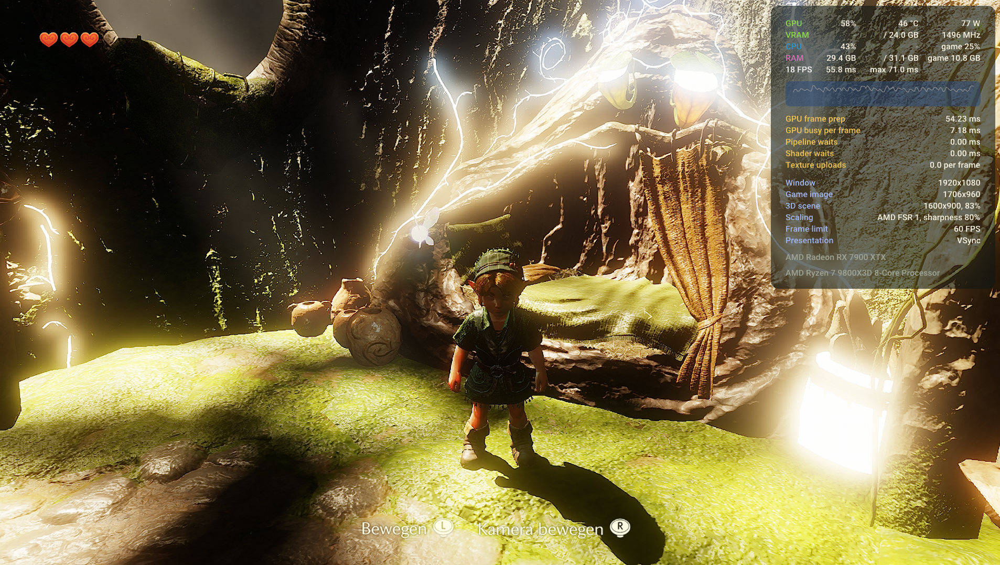

# OoT2026 PC Native Build | Development Update #01

**November 5, 2026 · Latest documented commit: `e6125e6`**

> **New gameplay follow-up:** Actual gameplay has now been tested and runs smoothly overall in the sections tested so far. Graphical glitches remain. [Watch the full gameplay video and read the latest update](https://ocarina-pc-native-build.github.io/#gameplay). The report below records the earlier milestone.

## We’re now in-game!

The build has progressed beyond the menus and now reaches an actual **3D in-game scene**, including the Deku Tree and dialogue. Basic movement appears possible, but the rendering problems need attention before we can properly assess gameplay.

**The next priority is fixing the overexposure, flickering and other graphical errors.**

*In-game development screenshot · November 5, 2026. Heavy overexposure is visible; graphics fixes are still in progress.*

### What has been implemented and fixed

- Native game code linked with the Windows runtime, with all 58 previously unresolved PACGA cases implemented and tested.
- AV1 video decoding added, alongside fixes for a reproduced thread-switch crash and shutdown hang.
- The startup black screen resolved by correcting incorrect sRGB texture-view usage.
- Game video, the title screen, main menu and options menu working, including tested menu navigation.

### Latest recorded test results

Testing on an **AMD Radeon RX 7900 XTX** showed **0 Vulkan errors in the tested menu/options path**. Shader error reports decreased from **464 to 111**.

**15 runtime checks, 17 project tests and 245 GPU checks passed.**

### Current focus

The in-game image is still heavily overexposed, with washed-out colours, flickering and other rendering defects. These issues are **not fixed yet**.

The next development work focuses on correcting lighting and colour output, eliminating flickering, and fixing the shader and rendering errors affecting the visible scene.

### Development status

This remains an **experimental development build**, not a finished playable release. Reaching the game is an important milestone, but reliable gameplay, longer-run stability and saving/loading still need verification. The previously reported longer-run CPU crash has not yet been confirmed resolved.

Thanks for following the progress and supporting the project!

---

[Project overview](README.md) · [Roadmap](ROADMAP.md) · [Website](https://ocarina-pc-native-build.github.io/) · [Discord](https://discord.gg/vDPAcc6JnY) · [Buy Me a Coffee](https://buymeacoffee.com/hotdevilsauce)

*The commit identifier refers to documented local game development; this website repository does not include that code history.*
